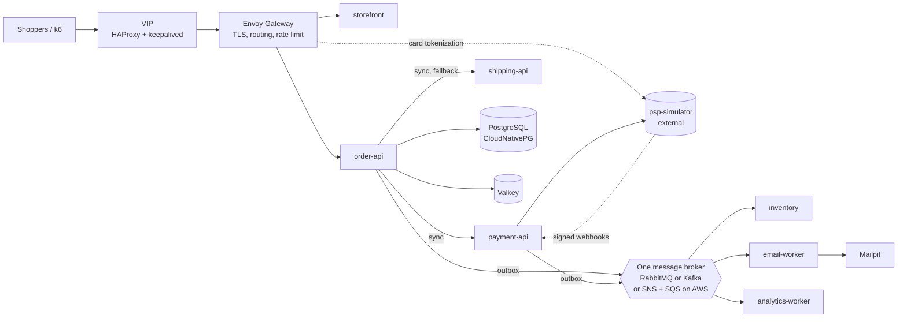

# LabFlow Platform

A self-managed Kubernetes platform, built with kubeadm, Terraform and Ansible, that runs the [LabFlow](https://github.com/thiagogenez/labflow) order-processing system in three scenarios: a local KVM datacenter, AWS, and a hybrid of both. The platform is then broken on purpose (load balancer loss, node and quorum failures, traffic bursts, upgrades, disaster recovery) and every failure gets a runbook.

LabFlow is a public learning lab for Platform Engineering and SRE practice. It runs on a laptop and on short-lived AWS sessions; it serves no real customers or traffic.

## Status

Planning is complete; implementation starts on 2026-11-19. This table is the source of truth for what exists.

| Capability | Status |
| --- | --- |
| Plan and design decisions | Done |
| Quality gate (pre-commit hooks, commit-message checks, CI) | Running in CI |
| Contribution workflow (issue forms, pull request template, ticket references, pull request check) | Configured, CI pending first run |
| Local datacenter (Lima + KVM, Terraform, Ansible, kubeadm) | Planned |
| Edge (HAProxy + keepalived VIP, MetalLB, Envoy Gateway, TLS) | Planned |
| Data services (CloudNativePG, Valkey) | Planned |
| Message brokers (Kafka, RabbitMQ, SNS + SQS) | Planned |
| GitOps (Argo CD local/hybrid, Flux on AWS) | Planned |
| Secrets and identity (Vault, External Secrets, RBAC personas, IRSA) | Planned |
| Observability (Prometheus, Grafana, SLO burn-rate alerts) | Planned |
| Load and autoscaling (k6, KEDA) | Planned |
| AWS scenario | Planned |
| Hybrid scenario | Planned |

## Target architecture

Target architecture, not yet implemented:

## Scenarios

| | Local | AWS | Hybrid |
| --- | --- | --- | --- |
| Machines | 8 KVM VMs inside a Lima VM: 3 control planes, 3 workers, 2 load balancers | EC2 t4g (ARM64): 1 control plane, 2 workers | Local cluster plus EC2 burst workers |
| Provisioning | Terraform (libvirt) + Ansible | Terraform + Ansible | Terraform + Ansible + WireGuard |
| CNI | Calico | Cilium | Calico |
| Load balancing | HAProxy + keepalived VIP, MetalLB | AWS NLB via cloud-provider-aws | As local |
| Messaging | Kafka or RabbitMQ (self-hosted) | SNS + SQS (native) | As local |
| GitOps | Argo CD | Flux | Argo CD |
| Runs | Most days | Short sessions, destroyed afterwards | Short sessions, destroyed afterwards |

## Documentation

- [Plan](docs/plan.md): day-by-day milestones, exit checks and failure drills.
- [Decisions](docs/decisions.md): what was decided, and why.
- [Contributing](CONTRIBUTING.md): tickets, checks, reviews, commits and pull requests.

## License

[MIT](LICENSE)
