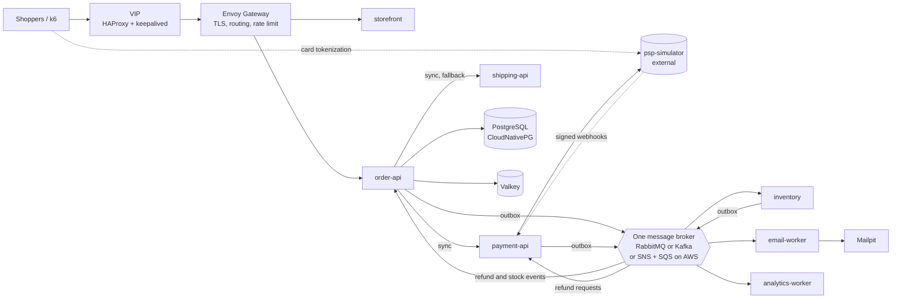

# LabFlow Platform

A Kubernetes platform that runs the [LabFlow](https://github.com/thiagogenez/labflow) order-processing system in three scenarios: a self-managed private KVM datacenter (kubeadm, Terraform, Ansible), the same system on AWS managed services provisioned with CloudFormation, and a hybrid in which AWS adds elastic capacity to the private platform. The platform is then broken on purpose (load balancer loss, node and quorum failures, total cluster loss, traffic bursts, upgrades, disaster recovery) and every failure gets a runbook.

LabFlow is a public learning lab for Platform Engineering and SRE practice. It runs on a laptop and on short-lived AWS sessions; it serves no real customers or traffic.

## Status

Planning is complete; implementation starts on 2026-11-20. This table is the source of truth for what exists.

| Capability | Status |
| --- | --- |
| Plan and design decisions | Done |
| Quality gate (pre-commit hooks, commit-message checks, CI) | Running in CI |
| Contribution workflow (issue forms, pull request template, ticket references, pull request check) | Configured, CI pending first run |
| Private datacenter (Lima + KVM, Terraform, Ansible, kubeadm) | Planned |
| Edge (HAProxy + keepalived VIP, MetalLB, Envoy Gateway, TLS) | Planned |
| Data services (CloudNativePG, Valkey) | Planned |
| Message brokers (Kafka, RabbitMQ, SNS + SQS) | Planned |
| GitOps (Argo CD private/hybrid, Flux on EKS) | Planned |
| Secrets and identity (Vault, External Secrets, RBAC personas, Istio ambient mTLS, IRSA, Pod Identity) | Planned |
| Observability (Prometheus, Grafana, SLO burn-rate alerts) | Planned |
| Load and autoscaling (k6, KEDA) | Planned |
| AWS scenario (CloudFormation, EKS Auto Mode, RDS, ElastiCache, SNS + SQS) | Planned |
| Hybrid scenario (burst Auto Scaling Group over WireGuard) | Planned |

## Target architecture

Target architecture, not yet implemented:

## Scenarios

| | Private | AWS | Hybrid |
| --- | --- | --- | --- |
| Compute | 8 KVM VMs inside a Lima VM: 3 control planes, 3 workers, 2 load balancers | EKS Auto Mode on Graviton | Private cluster plus an EC2 Auto Scaling Group of burst nodes |
| Provisioning | Terraform (libvirt) + Ansible + kubeadm | CloudFormation | As private, plus CloudFormation (WireGuard hub, burst nodes) |
| Network | Calico, then Cilium from Day 11 | VPC CNI | Cilium over WireGuard |
| Edge | HAProxy + keepalived VIP, MetalLB, Envoy Gateway | ALB, ACM, AWS WAF | As private |
| Data | CloudNativePG, Valkey | RDS, ElastiCache | As private |
| Messaging | Kafka or RabbitMQ | SNS + SQS | As private |
| GitOps | Argo CD | Flux | Argo CD |
| Runs | Most days | Short sessions, deleted afterwards | Short sessions, deleted afterwards |

## Documentation

- [Plan](docs/plan.md): day-by-day milestones, exit checks and failure drills.
- [Decisions](docs/decisions.md): what was decided, and why.
- [Contributing](CONTRIBUTING.md): tickets, checks, reviews, commits and pull requests.

## License

[MIT](LICENSE)
